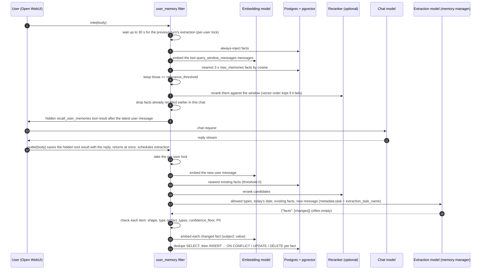

# How it works

Current as of filter v8.4.

**Inlet** (before the chat model sees the request; no model call):
1. First use only: open the store, create the extension/tables, and check the stored embedding model and
   dimension against Open WebUI's current one; on any difference, rebuild the `embedding` column and re-embed every row.
2. Embed the last `query_window_messages` user/assistant messages as one search text (waits for a still-running
   extraction from the previous turn).
3. `SELECT` the user's `always_inject_types` facts, plus the nearest other facts by cosine distance
   (`embedding <=> query`) with similarity ≥ `relevance_threshold`. When Open WebUI has a reranker configured
   (`request.app.state.RERANKING_FUNCTION`), the candidates are rescored by it; if the reranker fails or returns no
   scores, the vector order is kept. The top `max_memories` are kept.
4. Leave out the facts already recalled earlier in this chat, render the rest grouped by type, and add them as a
   hidden tool result right after the latest user message (see below).

**Outlet** (after the reply is streamed): save the hidden tool result with the reply, schedule a background task,
return immediately. The task embeds the
(scrubbed) latest user message and sends `memory-manager` the allowed fact types (the `fact_types` valve), today's date, the `always_inject_types` facts plus the
`max_memories` nearest existing facts (each with its `last_updated` date), the previous 3 user messages as context and
the latest user message, and asks only for what changes: new facts, updated facts (same type+subject), and
`"remove": true` entries. The prompt tells the model not to store passing states (sleep, mood, energy, "today" /
"last night"), to return a stored passing-state `status` fact as a removal whenever it sees one, and never to overwrite an ongoing status with a one-day report; long-running situations are never expired. Nothing changes
on most turns and the reply is `{"facts": []}`. Each change is embedded (`subject: value`) and applied to its own row:
removal is a `DELETE`; a new `(type, subject)` whose embedding is ≥ `dedupe_threshold` similar to an existing fact of
the same type is applied to that row instead (logged as *merged*); otherwise `INSERT ... ON CONFLICT` writes value,
sentiment, confidence and embedding only when something differs. Empty or unparseable replies write nothing.
A per-user lock serialises the task with the next inlet: the inlet waits up to 30 s for a running extraction, then
recalls without that turn's new facts. The extraction model call is given 300 s; after that the turn's update is
skipped. The filter's own log lines never contain the extraction model's reply or the text a PII check matched (Open WebUI
itself logs request bodies when its log level is DEBUG). Only user messages are sent; system prompts carry persona
text that would be misread as facts.

**Storage**: table `user_facts` (`user_id, type, subject, value, sentiment, confidence, first_mentioned,
last_updated, embedding vector(N)`, primary key user + type + subject, HNSW cosine index when N ≤ 2000) and
`user_facts_meta` (one row: `embedding_model`, `embedding_dim`). N is whatever Open WebUI's embedding model returns.

## Where the memories are injected

The recalled memories reach the model as the result of a hidden tool call named `recall_user_memories`, placed right
after the latest user message, under a `[Relevant memories about the user]` header. It is not a tool the model can
call, and nothing shows in the chat bubble. The outlet saves the same entry with the reply, so Open WebUI replays it
unchanged on every later turn: the persona system prompt, tool specs and chat history stay byte-identical from turn
to turn and the server reuses its prompt cache up to the new message (llama.cpp reuses the longest identical token
prefix). The entry is added on a new turn only; a continued reply already has it in its history.

A fact is sent once per chat. Before rendering, the inlet collects every line of the earlier recalls still in the
chat's history and leaves out the facts whose line is already there. A fact is sent again when anything on its line
changes, or when the earlier recall is no longer in the history the model gets: Open WebUI's context compaction has
summarized it away, or it sits on another branch or on a reply being regenerated. A block that leaves facts out says
in its header that a changed fact replaces its earlier version and the other facts recalled earlier still apply. When no fact is left, no entry is added for that turn, so
that turn carries no fresh `today is` date. The status line shows how many relevant facts are new and how many were
recalled earlier.

The block header carries today's date and says that relative words inside a fact refer to the fact's last stated
date, not to today. Every fact line shows all of its stored values:
`- Subject: value (sentiment negative, confidence 0.8, first stated YYYY-MM-DD, last stated YYYY-MM-DD)`, with dates
in the server's local zone. Preferences are rendered the same way as every other type. Confidence is displayed only;
it does not affect which facts are selected.

There is no placement valve. The alternatives were measured and rejected: appending the block to the latest user
message for that request only makes the server re-read everything after that message on the next turn; a separate
system message after the user turn is merged by Open WebUI into the first system message before sending; and
prepending to the system prompt re-prefills the whole conversation whenever the recalled set changes (65 s at 12.5k
tokens).

## Why the pieces are where they are

- **Retrieval has no model call** because the only thing that must be fast is the wait before the first token. Embedding + SQL + rerank is a few seconds, dominated by the rerank; an earlier relevance model on that path was slower and separated no better than cosine + reranker (see [history.md](history.md)).
- **Memories are a hidden tool result after the latest user message, saved with the reply**, so the persona prompt, tool specs and history are byte-identical across turns and llama.cpp reuses the cached prefix up to the new message. Measured alternatives: appending the block to the latest user message for that request only makes it disappear from history on the next turn, so the server re-prefills from that point; a separate system message is merged by Open WebUI into the first one (cache miss from the top); prepending to the system prompt re-prefilled the whole chat whenever the set changed (65 s at 12.5k tokens).
- **A fact is sent once per chat** because every saved recall is replayed on every later turn; sending the full block each turn would add one copy per turn to the history.
- **Extraction is a task, not the chat.** Any server-side call made with the chat's `request` inherits the chat's metadata (`chat_id`, user, session). A prompt-cache proxy keyed on the chat id (the SSD shim via `X-OpenWebUI-Chat-Id: {{CHAT_ID}}`) therefore mistakes the extraction prompt for a turn of the chat. `metadata.task` survives the merge because the chat's metadata has no `task` key; the connection header `X-OpenWebUI-Task: {{TASK}}` renders it, and the shim gives the call a task slot. The same mechanism Open WebUI uses for title/tags/queries and for its own Context Compaction (`task: context_compaction`).
- **The extraction model is its own workspace model** (`extraction_model_id`), so it can run on a smaller model or another server than the chat. The call happens after every reply; where it shares a server with the chat, `extraction_task_name` keeps it out of the chat's slot.
- **One row per fact** because updates and removals then touch one row, dedup can be done by embedding similarity (`dedupe_threshold`, "job" vs "occupation" measured 0.951), and a wrong fact cannot be copied forward.

## One turn, step by step

One chat turn:

Numbers worth keeping in mind when tuning: the rerank cost is `candidates x window tokens` (up to 3 x `max_memories` candidates after `relevance_threshold`; 6 messages of window by default); the extraction prompt does not grow with the chat's length; the history before the new
message is identical from turn to turn, and each fact is in it once.
